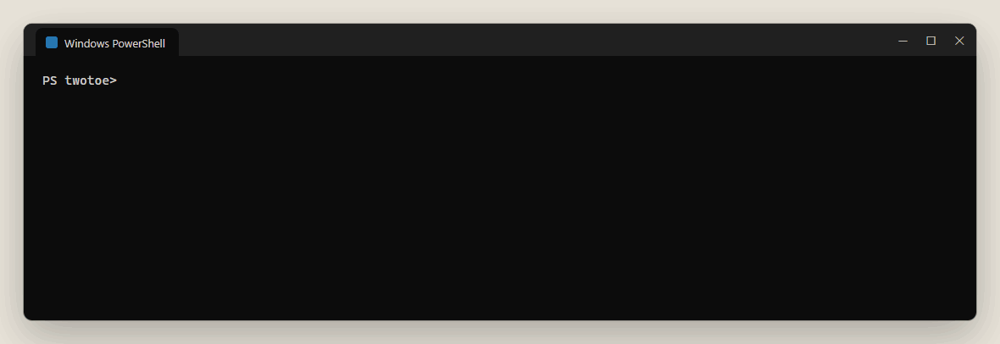
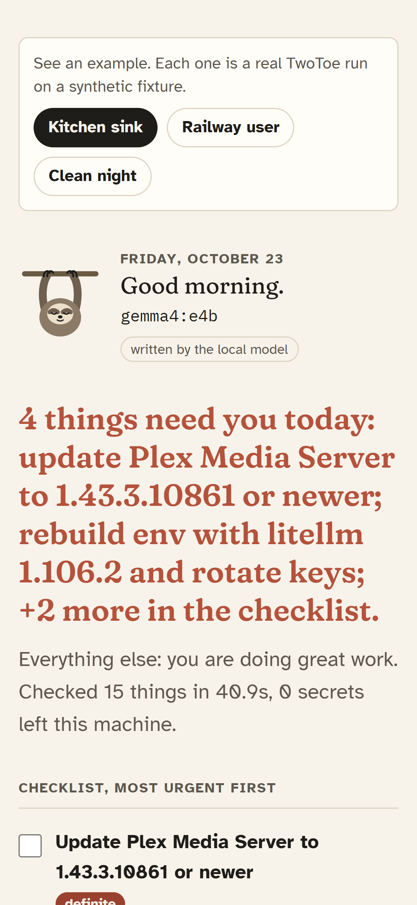
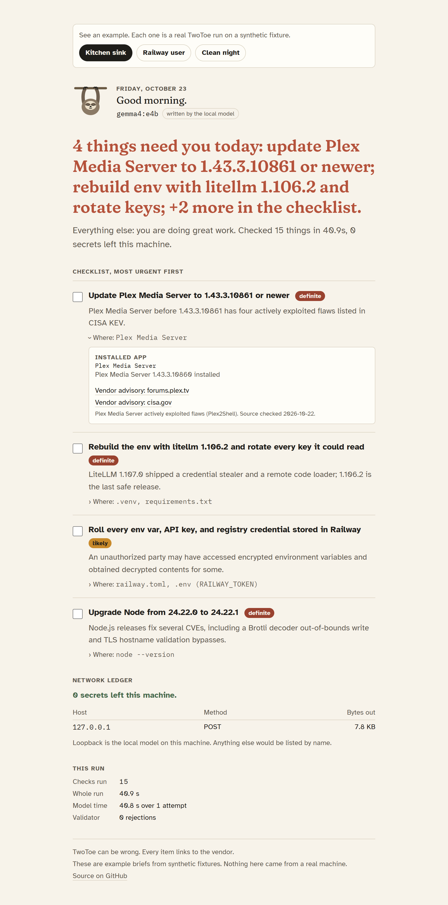
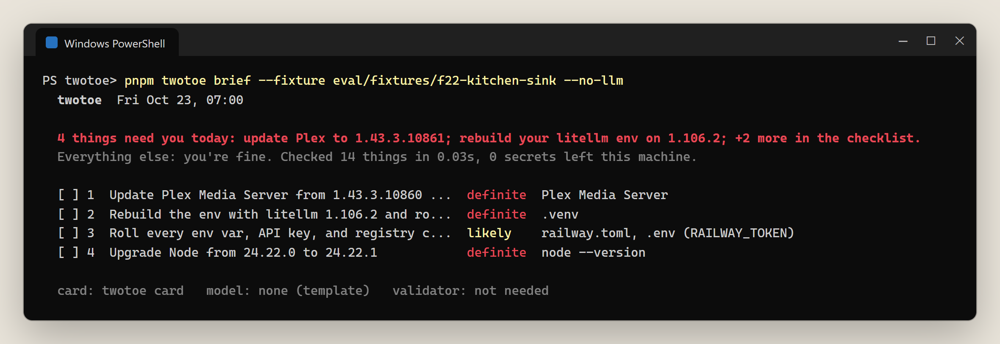
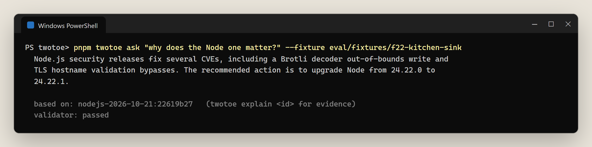
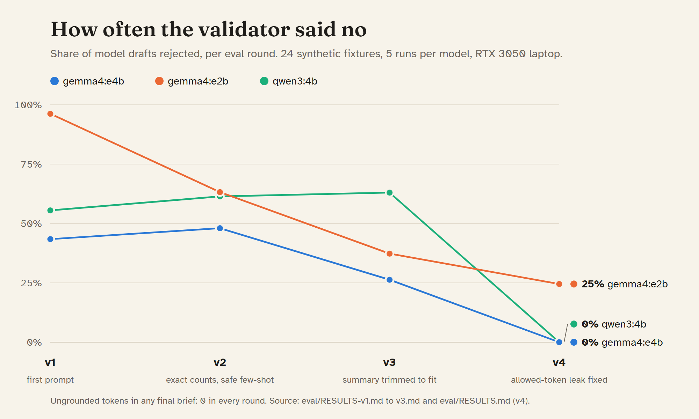
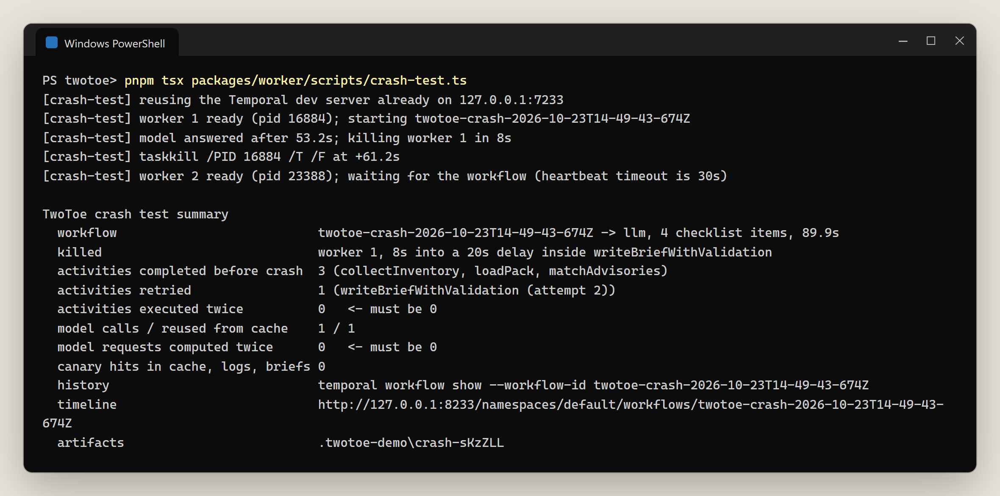
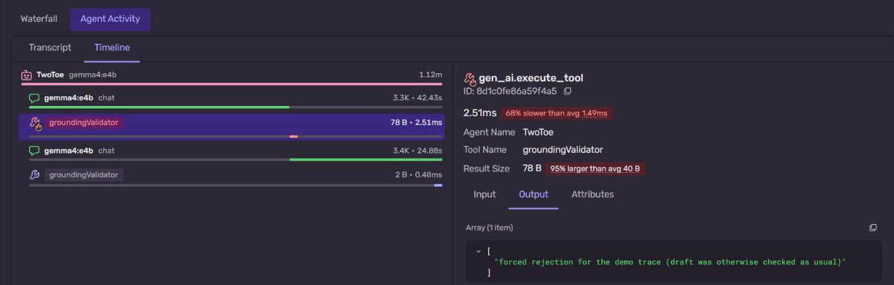
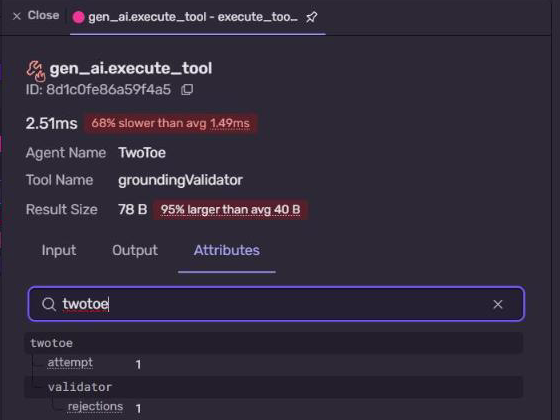
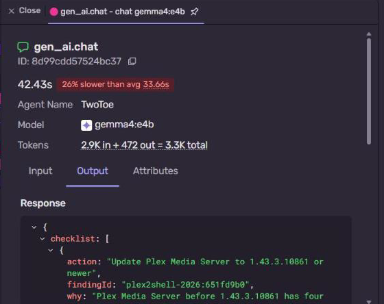

<!--
  DUMMY POST: a complete sample so the shape, length and image placement are clear.
  - Every number comes from docs/blog/info.md (section 5) and is real, EXCEPT anything marked [DUMMY: ...].
  - Replace every [DUMMY: ...] with a measured value, or cut the sentence. Never publish a dummy value.
  - Rewrite in your own voice. No em dashes anywhere.
  - Images: upload each file in the DEV editor and replace the relative path with the uploaded URL.
-->

*This is a submission for the [Hacktoberfest Open-Source AI Challenge, Week 3: Slow and Steady](https://dev.to/challenges/hacktoberfest-week3-2026-10-19).*

## What I Built

On Oct 21 a post went viral: "the internet broke today", ten incidents in one list. I checked every one. Eight are real. One number was off by about 2,000x. Some did not even happen "today".

The question I actually had was smaller: **which of these hit my machine, and what do I do before breakfast?** And the lazy shortcut, pasting my lockfiles and `.env` names into a chatbot, was exactly backwards: half of that week's incidents were leaked credentials.

So I built **TwoToe**, a sloth that does breach-week triage overnight, on my laptop, with a local open-weight model. At 3 a.m. it scans my projects and machine. In the morning I read two lines:



Then a checklist of at most seven items. Each one says what to do, why, where it was found, how sure TwoToe is (`definite`, `likely`, `possible`), and links the vendor advisory.

> **TL;DR**
> - Local agent, overnight, two lines and a checklist in the morning.
> - **Gemma 4 E4B** via Ollama on a Windows laptop (RTX 3050, 4 GB): 9.0 s median writer time, 19 tokens/s.
> - Matcher 20/20 on 24 synthetic fixtures. Four eval rounds, **0 invented facts in any final brief**.
> - Reads env key names, never values. Nothing leaves the machine except the CISA KEV feed request, and the brief proves it.
> - Survives being killed mid-thought (Temporal), and every model attempt is a span in Sentry.

## Demo

The morning card, on a phone:



The full card shows the checklist with evidence rows, the network ledger ("0 secrets left this machine", computed, never written by the model) and run stats:



[DUMMY: live demo link, if deployed. Otherwise: "Clone the repo and run `pnpm twotoe card`."]

## The fact-check

| # | Viral claim | Verdict | What the sources say |
|---|---|---|---|
| 1 | eMudhra: 8 keys, 60M+ certs at risk | Inflated | About 30,000 certs need migration; no source says 60M; no forged certs reported |
| 2 | SBI: 3,897 customers' data on the dark web | Confirmed | Regulation 30 filing, Oct 21 |
| 3 | Rajasthan Police, 70,000 records | Unverified | A forum claim. **Not in my pack.** |
| 4 | PHP "php2shell", CVSS 9.2 | Partly | Two CVEs, CVSS v4.0 9.2; "go offline" is for 8.1 and older; not in KEV |
| 5 | GitLab CVSS 10.0 unauthenticated RCE | Confirmed | Fixed in 7 branches on Oct 21 |
| 6 | Node.js Brotli RCE + TLS bypass, 10 CVEs | Confirmed | 10 CVEs, 4 High; fixed in 22.23.4, 24.22.1, 26.12.1 |
| 7 | Railway env vars decrypted | Confirmed (wording) | "may have" accessed, "some" decrypted, a subset of users |
| 8 | OpenCode provider keys exposed | Wrong date | Disclosed Oct 17; 1.4% of Console users |
| 9 | LiteLLM 1.107.0 was malware | Confirmed | 1.106.2 is the last safe release |
| 10 | Plex2Shell exploited, KEV deadline Oct 23 | Partly | Two CVEs due Oct 23, two due Nov 3 |

Every fact in TwoToe's advisory pack links to the page it came from and carries the date it was last checked.

## How I Built It

**Two walls around a small model.** Code decides what is true. The model only phrases it. Code checks what the model said.

```
scan (facts) -> matcher (no AI) -> Gemma writes -> validator (no AI) -> brief
                                                    rejected twice -> template
```

- **The matcher** turns an inventory (Node, PHP, Plex, Python packages, `.env` key names, malware indicator files) into findings. Each finding carries `allowedTokens`: the exact versions, CVE IDs, vendor names and numbers the model may say about it.
- **The validator** pulls every version, CVE, number and vendor name out of the model's text and rejects anything that finding did not allow. Hype words ("critical", "actively exploited") pass only when severity or CISA KEV status earns them.
- **The env scanner never holds a value.** [DUMMY: paste the key loop from `packages/core/src/scanners/envKeys.ts`.]
- **Temporal** runs it at 3 a.m. with an 18-hour catch-up window, so a run missed because the laptop was off happens when it is back.

Without the model, the same pipeline writes the brief from templates:



And you can ask a follow-up, answered only from tonight's findings, through the same validator:



## What Broke

**Four eval rounds. Each fix was right about the symptom; the drafts pointed at the real cause every time.**



- **v1:** the models restated facts in the wrong section and copied my prompt's own example ("bump Node to 24.22.1") into a brief about OpenCode. 141 of 405 drafts contained a fact code had not established. The validator caught every one.
- **v2:** zero inventions, but more rejections for length. The models copied the full advisory summary word for word and ignored the short one I put right next to it.
- **v3:** I hid the full summary. 87 drafts still contained it. The leak was mine: the list of allowed tokens carried the whole sentence.
- **v4:** fixed. gemma4:e4b and qwen3:4b had **zero** rejected drafts; gemma4:e2b still had 23 of 94, all formatting.

**The catch in that zero.** The validator did not get looser; the models got closer to the facts they were handed. Gemma kept the template's action word for word in 79 of 95 items, and its most personal touch is a line-2 tail: "take a deep breath." (46 of 80 briefs). [DUMMY: blind test, two readers ranked template vs model on 6 fixtures: X preferred the model, Y the template, Z same.]

Other things I only found by using it:
- TwoToe's first real run warned that **it was itself running on an unpatched Node**, and that this Node still trusted the eMudhra root.
- My model warm-up did not warm anything: it loaded the model with a different context size, so the first brief reloaded it (45 s instead of 29.5 s). A screenshot gave it away.
- Temporal's history held my home path and my PC's name, visible in the Temporal UI. The test meant to catch that could never fail. Both fixed.

What the validator cannot see: it checks tokens, not meaning. "You are not affected" would pass. That is a known gap, not a solved problem.

## Why Does Open Innovation Matter?

Railway, OpenCode and LiteLLM were all credential incidents. A triage tool that needs your credentials in someone else's cloud is just incident number eleven.

Local model, local facts. It works offline, it works when your cloud keys are revoked mid-incident, it costs nothing per night, and swapping the model is one setting.

## My Agent Session

I built TwoToe with Claude Code running natively on Windows, one phase at a time, with a hard stop at every gate: 37 of my messages, 1,060 tool calls, over two days. The whole session is in the repo, redacted: [the conversation](https://github.com/T-RexBytes/twotoe/blob/main/docs/blog/agent-session.md) and [the full log with every command](https://github.com/T-RexBytes/twotoe/blob/main/docs/blog/agent-session-full.md). [DUMMY: pick one moment to quote, for example the validator catching the spec's own example leaking into briefs.]

## The Lazy Payoff

Manual triage of the viral list against my own machine: [DUMMY: N] minutes with a stopwatch. TwoToe: [DUMMY: S] seconds, while I was asleep. Then I fixed [DUMMY: K] things before breakfast.

And the part I like most: I killed it mid-thought, and it finished anyway.




Three activities were done before the kill, one was retried, **none ran twice**, and the model's finished answer was reused from cache instead of being computed again.

## Prize Categories

- **Gemma:** Gemma 4 E4B is the writer, run locally; bake-off against gemma4:e2b and qwen3:4b over four eval rounds.
- **Temporal:** the nightly run is a Temporal workflow with a catch-up window; the crash test kills the worker mid model-call and the run finishes with 0 duplicate executions.
- **Sentry Agent Tracing:** every run is one trace; each model attempt and each validator verdict is a span. Here the first validator call is red and says why:



The rejection is data on the span, next to the model's token counts:





*Honesty note: the first rejection in this demo trace was forced (`--force-reject-first`) so the retry would show, and the span says so. Prompts are attached only in demo mode on test fixtures.*

[DUMMY: .tech domain and DigitalOcean only if the card is deployed.]

## Sources

Railway: https://blog.railway.com/p/security-disclosure-wednesday-october-21st
Node.js: https://nodejs.org/en/blog/vulnerability/october-2026-security-releases
PHP: https://www.php.net/ and https://www.cisa.gov/news-events/alerts/2026/10/21/critical-vulnerabilities-php-require-immediate-patching
GitLab: https://docs.gitlab.com/releases/patches/patch-release-gitlab-19-5-1-released/
Plex: https://forums.plex.tv/t/important-security-update-for-plex-media-server-v1-43-2-and-earlier/942319
LiteLLM: https://docs.litellm.ai/blog/security-incident-oct-21-2026
eMudhra: https://bugzilla.mozilla.org/show_bug.cgi?id=2083449
OpenCode: https://thehackernews.com/2026/10/opencode-console-breach-may-have.html
SBI: https://internetfreedom.in/sbi-told-investors-its-data-breach-doesnt-matter-what-about-the-3-897-customers-it-affected/
CISA KEV: https://www.cisa.gov/sites/default/files/feeds/known_exploited_vulnerabilities.json

Code: https://github.com/T-RexBytes/twotoe [DUMMY: make the repo public first]
